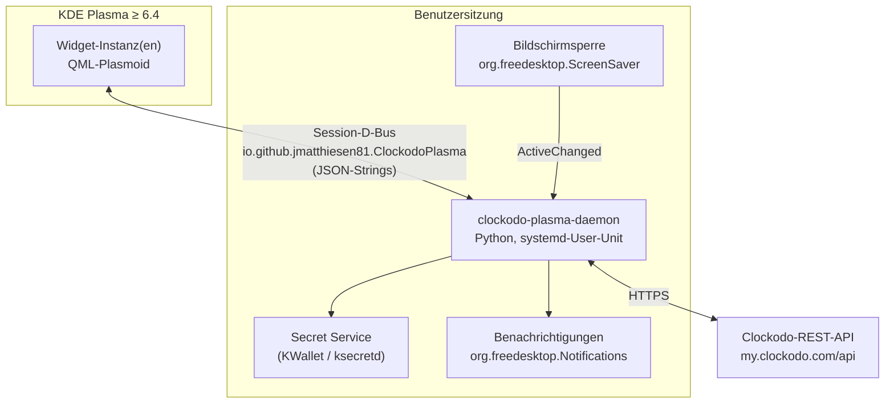

# Überblick

Clockodo Plasma ist ein inoffizielles KDE-Plasma-6-Widget für die Kontrollleiste zur Zeiterfassung mit dem Dienst [Clockodo](https://www.clockodo.com/). Es zeigt, ob die Uhr läuft, sowie die heutige Arbeitszeit, und startet, stoppt oder wechselt die Uhr mit einem ausdrücklich gewählten Buchungskontext.

## Zweck

Clockodo bietet Desktop-Apps nur für Windows und macOS an. Dieses Projekt bringt die häufigsten Aktionen in die Plasma-Kontrollleiste eines CachyOS-/Arch-Linux-Desktops:

- auf einen Blick sehen, ob Zeit erfasst wird und wie viel Arbeitszeit heute angefallen ist,
- die Uhr auf Kunde › Projekt › Leistung starten, stoppen oder auf einen anderen Kontext wechseln,
- erinnert werden, wenn der Bildschirm gesperrt ist, während die Uhr noch läuft.

Clockodo bleibt die einzige Quelle der Wahrheit. Es gibt keine lokale Datenbank und keine Offline-Buchung; das Widget bucht nie etwas ohne Klick. Das wichtigste Qualitätsziel lautet **keine Fehlbuchungen** (siehe [Architektur – Buchungssicherheit](architecture.md#buchungssicherheit)).

## Funktionen

| Funktion            | Verhalten                                                                                                                                                                                 |
| ------------------- | ----------------------------------------------------------------------------------------------------------------------------------------------------------------------------------------- |
| Kontrollleiste      | Heutige Gesamtzeit `HH:MM` als Ring (Fortschritt zum Tagessoll), Stoppuhr oder Pille; grün bei laufender, orange bei gestoppter Uhr, rot über Soll; abgeblendet und kursiv, wenn veraltet |
| Popup               | Status, Gesamtzeit und Soll, laufender Kontext, Schnellstart, Starten/Stoppen/Wechseln, zuletzt verwendete Kontexte                                                                       |
| Schnellstart/-stopp | Taste + Linksklick (Standard Strg), Mittelklick oder Kontextmenü; startet die Standardbuchung oder stoppt den angezeigten Eintrag                                                         |
| Kontextmenü         | Schnellstart/-stopp, Start/Wechsel mit Auswahl, Wechsel zur Standardbuchung, zuletzt verwendete Kontexte                                                                                  |
| Tagessoll           | Aus den Clockodo-Sollstunden; rot und optional eine Warnung mit *Stoppen*-Knopf bei Überschreitung                                                                                        |
| Buchungskontext     | Kunde › Projekt (optional) › Leistung, fünf zuletzt verwendete Kontexte, optionale Beschreibung                                                                                           |
| Synchronisierung    | Intervall aus/30 s/1/2/5 min (Standard 1 min), sofort beim Öffnen des Popups, Back-off bei Fehlern                                                                                        |
| Externe Änderungen  | Starts/Stopps auf anderen Geräten werden erkannt und als Hinweis angezeigt                                                                                                                |
| Zugangsdaten        | E-Mail und API-Schlüssel im Secret Service (KWallet), vor dem Speichern gegen Clockodo geprüft                                                                                            |
| Erinnerungen        | Bildschirm gesperrt, während die Uhr läuft; nach Rückkehr aus dem Ruhezustand; optional nach N Stunden                                                                                    |
| Sprachen            | Englisch und Deutsch, in den Einstellungen wählbar (Standard: Systemsprache, sonst Englisch)                                                                                              |
| Verteilung          | Arch-Paket (`arch=any`) aus einem eigenen pacman-Repository; GitHub-Releases enthalten den Quellcode                                                                                      |

## Architektur im Überblick

- Das **Widget** zeigt nur den vom Daemon veröffentlichten Zustand an und leitet Klicks weiter. Es hat keine eigene Logik für Buchungen.
- Der **Daemon** enthält die gesamte Logik: API-Client, Polling, Zustand, Buchungssicherheit, Zugangsdaten, Erinnerungen. Ein Daemon bedient alle Widget-Instanzen, es gibt also nur einen Poller.
- Der Daemon wird bei Bedarf per **D-Bus-Aktivierung** über seine systemd-User-Unit gestartet; ein Autostart-Eintrag ist nicht nötig.

Warum zwei Teile: QML hat keinen Zugriff auf den Secret Service, ein reines QML-Widget müsste den API-Schlüssel daher im Klartext in der Plasma-Konfiguration ablegen; zudem würde jede Widget-Instanz für sich pollen. Die Gründe für diese und weitere Entscheidungen stehen unter [Architektur – Designentscheidungen](architecture.md#designentscheidungen).

## Nicht-Ziele

- Keine Kunden- oder Projektverwaltung, keine Auswertungen oder Berichte.
- Keine eigene Datenbank, keine Offline-Buchungen, keine spätere automatische Nachbuchung.
- Kein automatischer Stopp, auch nicht bei Bildschirmsperre oder Ruhezustand; das Widget erinnert nur.
- Keine Abwesenheiten, kein OAuth 2.0 (der API-Key genügt) – später möglich.
- Keine Binärpakete auf GitHub, kein zweites pacman-Repository, keine Veröffentlichung im AUR oder KDE Store.

## Verwandte Projekte und Benennung

- Clockodo bietet keine offizielle Linux-App. Es gibt das Community-Projekt [Klockodo](https://github.com/qupaya/Klockodo) (Kotlin/Native, GTK3, Statusleiste); ob es gepflegt wird und denselben Bedarf abdeckt, ist noch nicht geprüft.
- „Clockodo“ wird nur beschreibend verwendet („Widget für Clockodo“); das Widget nutzt kein Clockodo-Logo, und alle technischen Namen liegen im eigenen Namensraum `io.github.jmatthiesen81` (der Namensraum `org.clockodo` gehört Clockodo). Vor einer Veröffentlichung im KDE Store erneut prüfen.

## Status

Version 0.2.0 ist implementiert und mit Unit-Tests, D-Bus-Tests, einer Paketprüfung und einem Lauf in `plasmoidviewer` in einem Arch-Container getestet. Version 0.2.0 läuft außerdem in einer echten Plasma-Sitzung unter CachyOS gegen ein echtes Clockodo-Konto, einschließlich Starten, Stoppen und Wechseln. Siehe [Befunde](findings.md).

[Index](index.md) · [English](../en/overview.md)
