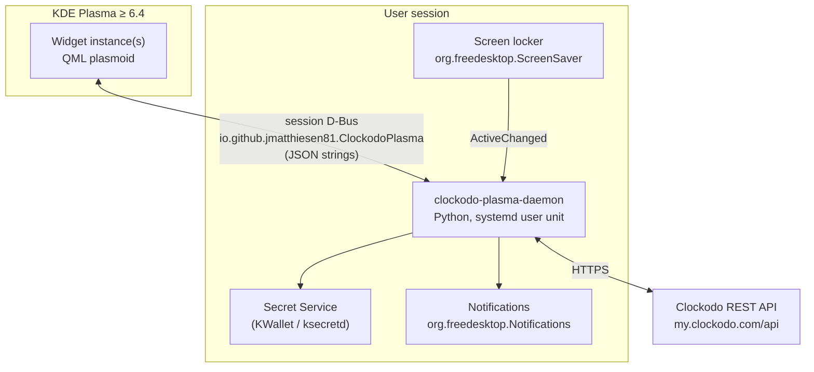

# Overview

Clockodo Plasma is an unofficial KDE Plasma 6 panel widget for the [Clockodo](https://www.clockodo.com/) time tracking service. It shows whether the clock is running and today's work time, and starts, stops or switches the clock with an explicitly chosen booking context.

## Purpose

Clockodo offers desktop apps only for Windows and macOS. This project brings the most frequent actions into the Plasma panel of a CachyOS/Arch Linux desktop:

- see at a glance whether time is being recorded and how much work time today has,
- start the clock on customer › project › service, stop it, or switch to another context,
- get reminded when the screen is locked while the clock still runs.

Clockodo stays the only source of truth. There is no local database and no offline booking; the widget never books anything without a click. The most important quality goal is **no wrong bookings** (see [Architecture – Booking safety](architecture.md#booking-safety)).

## Features

| Feature          | Behavior                                                                                                                                                      |
| ---------------- | ------------------------------------------------------------------------------------------------------------------------------------------------------------- |
| Panel            | Today's total `HH:MM` as ring (progress to the daily target), stopwatch or pill; green running, orange stopped, red over target; dimmed and italic when stale |
| Popup            | Status, total and target, running context, quick start, start/stop/switch, recently used contexts                                                             |
| Quick start/stop | Key + left click (default Ctrl), middle click or context menu; starts the default booking or stops the shown entry                                            |
| Context menu     | Quick start/stop, start/switch with selection, switch to the default booking, recently used contexts                                                          |
| Daily target     | From Clockodo's target hours; red and an optional warning with a *Stop* button when exceeded                                                                  |
| Booking context  | Customer › project (optional) › service, five recently used contexts, optional description                                                                    |
| Synchronisation  | Interval off/30 s/1/2/5 min (default 1 min), immediately when the popup opens, back-off on errors                                                             |
| External changes | Starts/stops on other devices are detected and shown as a notice                                                                                              |
| Credentials      | E-mail and API key in the Secret Service (KWallet), checked against Clockodo before saving                                                                    |
| Reminders        | Screen locked while running; after resume from suspend; optionally after N hours                                                                              |
| Languages        | English and German, chosen in the settings (default: system language, otherwise English)                                                                      |
| Distribution     | Arch package (`arch=any`) from an own pacman repository; GitHub releases carry the source                                                                     |

## Architecture at a glance

- The **widget** only displays the state the daemon publishes and forwards clicks. It has no logic of its own for bookings.
- The **daemon** holds all logic: API client, polling, state, booking safety, credentials, reminders. One daemon serves all widget instances, so there is only one poller.
- The daemon is started on demand by **D-Bus activation** through its systemd user unit; it needs no autostart entry.

Why two parts: QML has no access to the Secret Service, so a pure QML widget would have to keep the API key in plain text in the Plasma configuration; and every widget instance would poll on its own. The reasons for this and other decisions are in [Architecture – Design decisions](architecture.md#design-decisions).

## Non-goals

- No customer or project management, no reports or evaluations.
- No own database, no offline bookings, no automatic re-booking later.
- No automatic stop, not even on screen lock or suspend; the widget only reminds.
- No absences, no OAuth 2.0 (the API key is enough) – possible later.
- No binary packages on GitHub, no second pacman repository, no AUR or KDE Store publication.

## Related projects and naming

- Clockodo has no official Linux app. The community project [Klockodo](https://github.com/qupaya/Klockodo) (Kotlin/Native, GTK3, status bar) exists; whether it is maintained and covers the same needs has not been checked yet.
- "Clockodo" is used only descriptively ("widget for Clockodo"); the widget uses no Clockodo logo, and all technical names live in the own namespace `io.github.jmatthiesen81` (the name space `org.clockodo` belongs to Clockodo). Check this again before a KDE Store publication.

## Status

Version 0.2.0 is implemented and tested with unit tests, D-Bus tests, a package check and a run in `plasmoidviewer` in an Arch container. Version 0.2.0 also runs in a real Plasma session on CachyOS against a real Clockodo account, including start, stop and switch. See [Findings](findings.md).

[Index](index.md) · [Deutsch](../de/overview.md)
